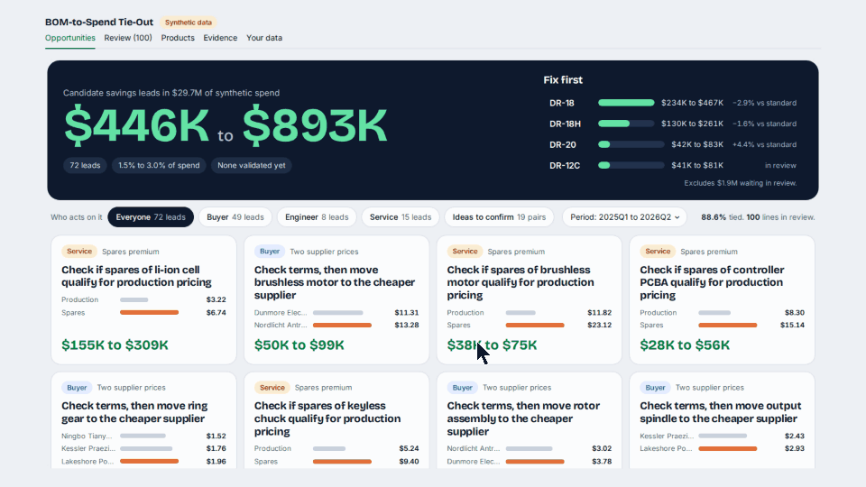
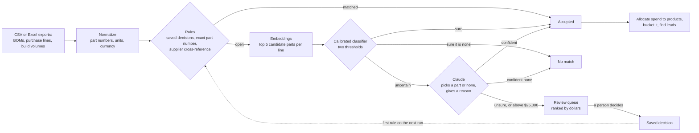
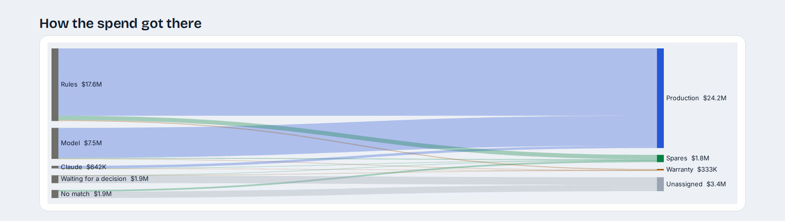
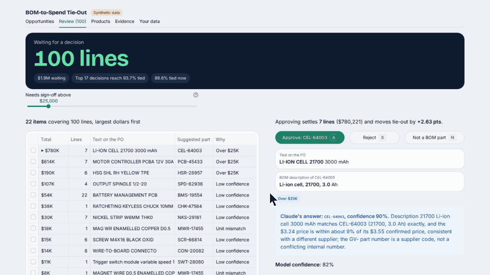

# BOM-to-Spend Tie-Out

Ties a manufacturer's purchase lines to its bills of materials (BOMs) from messy CSV exports, with no system integration, and turns the result into savings leads a buyer can check.



Built solo at the Kearney PERLab x Velocity AI Hackathon (Corporate Track 3, BOM Cost Linkage), November 2026.

I directed the design, experiments and decisions, and used Claude Code to write the code.

**The data in the app is synthetic.** The products, parts, suppliers, prices and purchase lines are generated, and the true matches are planted so accuracy can be measured. Two further tests use real data; the results table says which.

## What it does

- **Matches each purchase line to a BOM part,** even when the part number is a supplier's or a plant's own code and the description is abbreviated, misspelled or in Spanish.
- **Declines when unsure.** Every line ends as accepted, sent to a person, or "no match", and each match carries its evidence and a written reason.
- **Reports the tie-out rate:** the share of spend that ties to a product, split into production, spares, warranty and unassigned.
- **Estimates what each product really cost in parts,** next to its BOM standard cost.
- **Surfaces savings leads as dollar ranges:** the same part at two supplier prices, spares bought at a premium, duplicate part numbers, and parts bought beyond what the builds required.

## Results

| Test | Data | Precision | Recall | Also |
|---|---|---|---|---|
| Held-out noise styles | **Synthetic.** 1,708 purchase lines ($10.1M) written in styles the matcher was never tuned on | 100.0% | 98.8% | Tie-out 97.9% against a true 98.8%; 18 lines ($55K) left for a person; $0 tied to a wrong part |
| Abt-Buy product matching | **Real** listings from two shops, fixed public test split (710 pairs) | 0.98 | 0.91 | F1 0.94; the baselines published with the benchmark reach 0.81 and 0.85 |
| Electronic parts, part number visible | **Real** open-hardware BOMs against a real catalog of 4.3M parts, plus 500 real public purchase-order lines that match nothing | 0.99 | 0.76 | 99.6% of the no-match lines correctly left unmatched |
| Electronic parts, part number hidden | Same, with the manufacturer part number removed | 0.97 | 0.16 | A line like "Red LED 5mm" does not identify one catalog part, so the tool declines instead of guessing |

Nothing was retrained for the real-data tests. Precision is the share of accepted matches that are right; recall is the share of lines with a true part that were accepted correctly.

On the full synthetic dataset (4,487 lines, $29.7M) the app reports an 88.6% tie-out rate against a true 94.9%, with 100 lines ($1.91M) waiting for a person. That gap is deliberate: a match that only Claude vouched for and that is worth more than $25,000 goes to a reviewer. It finds 72 leads worth $446K to $893K, shown as ranges and not as booked savings.

The stage-by-stage table, costs, buckets and every experiment are in [docs/results.md](docs/results.md).

## How it works





*Where the synthetic sample's $29.7M went: rules and the model settle most of it, Claude a thin band, and the rest waits for a person or matches nothing.*

Cheap exact rules settle the easy lines. A small classifier, trained only on the tuning split, accepts a match only above a threshold set for at least 99% precision. Claude sees only the uncertain middle band, so cost follows how messy the data is and not how large it is: 392 calls and $3.12 for the whole dataset. Whatever is still uncertain goes to a person, largest dollars first, and each decision becomes a rule for the next run.

For uploaded files the classifier is skipped (see "What I tried"), so rules, embeddings and Claude do the matching.



## What I tried

| # | Experiment | Result | Decision |
|---|---|---|---|
| 1 | Synthetic drill family with planted matches; five naming styles held out from tuning | Accuracy can be measured, and not only on styles the matcher was tuned on | Kept as the test bed |
| 2 | Plain part-number lookup, then rules, then rules plus embeddings with one similarity cutoff | Tie-out 27.5%, then 34.2%, then 84.1%, but the last at 95.3% precision with $86,119 tied to the wrong part | A single cutoff is not safe enough; add a classifier with an option to abstain |
| 3 | Calibrated classifier with accept, review and no-match outcomes | Precision back to 100%, but 328 lines ($2.35M) left in review | Kept; send the review band to Claude |
| 4 | Claude on the review band only | Tie-out 97.9% at 100% precision; review queue down to 18 lines ($55K) | Kept |
| 5 | Hosted embeddings against a small local model | True part ranked first for 95.7% of open lines against 90.2% | Hosted model for results; local model stays as the no-key fallback |
| 6 | **A smaller Claude model** (Haiku 5.5 in place of Opus 5.5) | **Failed.** $0.10 against $3.12, but its picks never reached 99% precision on the tuning split, so none could be auto-accepted and 274 lines ($2.25M) stayed in review | Kept the larger model; $3 is small next to the review time saved |
| 7 | Send Claude-only matches above $25,000 to a person | Tie-out drops from 93.9% to 88.6%; about $1.6M waits in review | Kept. A wrong match at that size would undo a savings claim |
| 8 | Zero-shot test on real product listings (Abt-Buy) | F1 0.94 against 0.81 and 0.85 for the published baselines | Kept as outside evidence |
| 9 | **Model transfer:** the classifier trained on synthetic drill parts, run on real electronic parts | **Failed.** With the part number hidden it accepted 1 of 208 lines. Rules and Claude carried the test | Uploaded files skip the classifier |
| 10 | Upload flow where Claude maps unknown column names | All 25 columns right on a second sample; 99.7% precision, 97.5% recall | Kept, with the mapping confirmed by the user before anything runs |
| 11 | **Self-training:** train the classifier on a dataset's own rule-matched lines, with no confirmed labels | **Failed.** Synthetic: precision fell to 96.5% with $75,999 tied to the wrong part. Real parts: recall moved from 0.00 to 0.02 | Dropped. The classifier needs reviewer-confirmed matches, which the saved decisions collect |
| 12 | Unit conversion, scrap and multi-level BOMs; a bought-versus-required lead | All 4 lines bought in the wrong kind of unit were caught. One of two planted over-purchases found; magnet wire was missed | Kept; the miss is reported |
| 13 | **Retraining side effect:** the classifier, retrained after the BOM gained units and scrap, on the real-parts test | **Got worse.** It now calls about half the hidden-part-number lines "no match" outright, and recall after Claude fell from 0.28 to 0.16 | Reported the current number; further evidence the classifier does not transfer |
| 14 | **No-match rule added after seeing held-out results:** an item worth over $25,000 cannot be closed as "no match" by the classifier alone | Spend wrongly dropped fell from $43,572 to $13,536; review grew from 11 to 18 lines | Kept, but its "after" numbers are not a clean held-out measurement and are labelled so |
| 15 | Do saved decisions cut review work over six quarters? | 26 review lines against 97. Item text repeats by construction in this data, so the size of the effect is not evidence about a real company | Kept the feature; the number is not a headline |
| 16 | Effective-dated BOM revisions, with two engineering changes purchasing did not follow | Two new over-purchase leads, both real gaps in the data; purchase lines and matching decisions unchanged | Kept |
| 17 | Similar parts to consolidate (same family, one spec within 15%) | 19 pairs worth $316K to $633K, but unmeasured, and some are plainly not interchangeable (two bearing sizes) | Shown as "Ideas to confirm", kept out of the headline total |

## Limits

- **Accuracy is measured on synthetic noise.** Real exports will be messy in ways the generator does not model. The real-data tests show the approach carries over; they do not show these accuracy figures do.
- **The classifier does not transfer between companies.** It has to be trained on a company's own confirmed matches. Until those exist, matching relies on rules and Claude, and more lines go to review.
- **"No match" is the weak spot.** On held-out lines 96.6% of no-match calls are right, and $13,536 of spend that does have a BOM part is dropped.
- **Recall is low when a description does not identify one part.** With the part number hidden, real electronic parts reach 0.16 recall.
- **Product cost is an estimate.** Purchases show what was bought, not what was consumed; spend is split across products by BOM quantity times units built.
- **Leads are leads.** A price gap still needs volume, timing and qualification checks, so each is a range from half the gap to all of it.
- **No ERP connection.** It reads exports; nothing is written back.
- **The hosted app is capped:** 5 MB per file, 2,000 purchase lines and 150 Claude calls per run. Uploaded text is sent to OpenAI and Anthropic for matching.

## Run it locally

Needs Python 3.12 and [uv](https://docs.astral.sh/uv/).

```
uv sync
uv run streamlit run app.py
```

Then open http://localhost:8501. The app reads the committed results in `out/`, so the built-in sample and "Try the second sample" need no API keys.

To match your own files, copy `.env.example` to `.env.local` and fill in the keys: `ANTHROPIC_API_KEY` for Claude and `OPENAI_API_KEY` for embeddings. `.env.local` is gitignored; keys never go in the repo.

To rebuild the results:

```
uv sync --extra local
python3 -m src.generate               # the synthetic data, fixed seed
uv run python -m src.evaluate step2   # rules and embeddings
uv run python -m src.evaluate step3   # classifier and Claude; needs OPENAI_API_KEY
uv run python -m src.evaluate step4   # buckets, allocation, leads
```

Claude's answers are committed under `cache/llm/`, so no Anthropic key is needed unless the data or prompts change.

## More

- [docs/app.md](docs/app.md): each tab with a screenshot
- [docs/results.md](docs/results.md): every table, experiment and data source, with licenses
- [docs/deploy.md](docs/deploy.md): hosting on Streamlit Community Cloud, secrets and limits

## License

[MIT](LICENSE)
