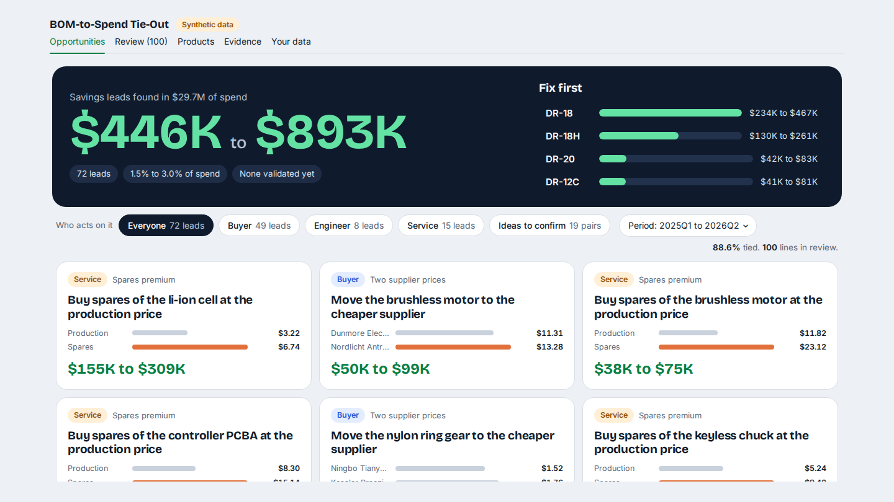
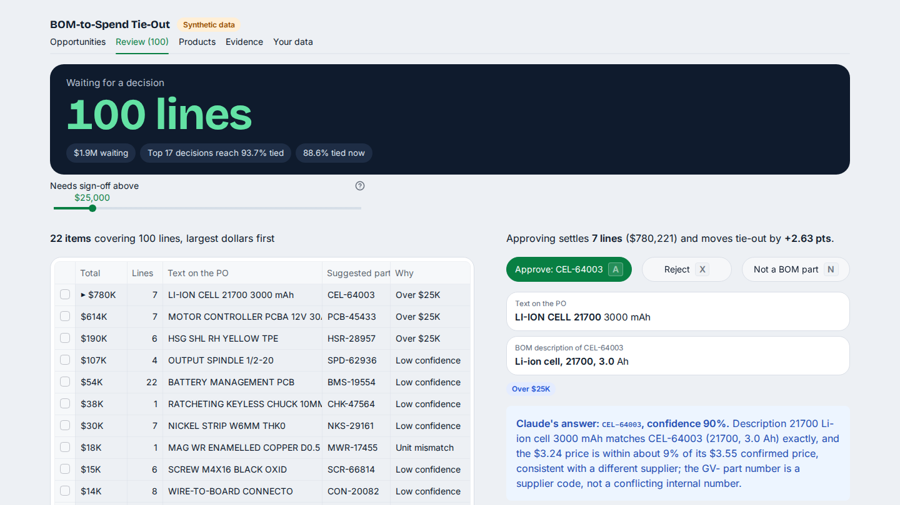
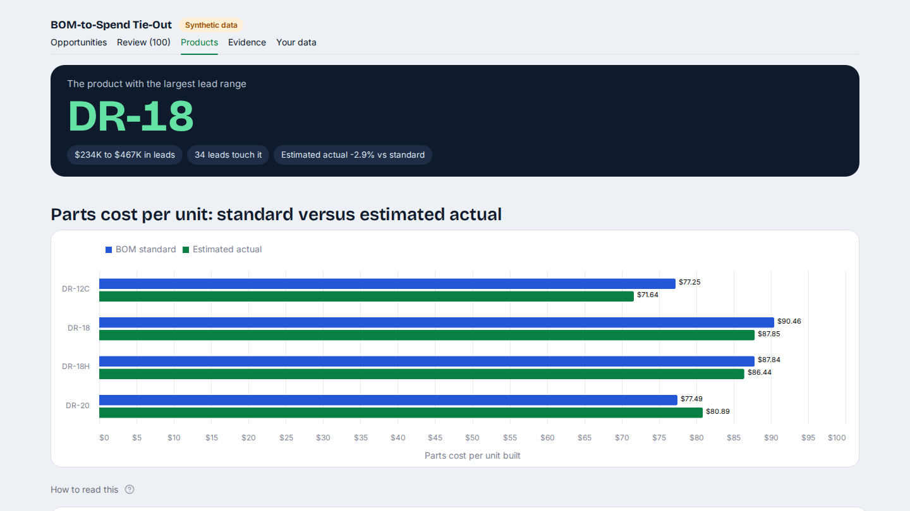
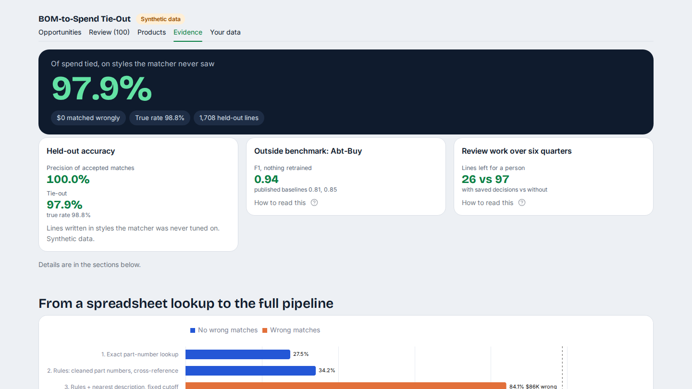
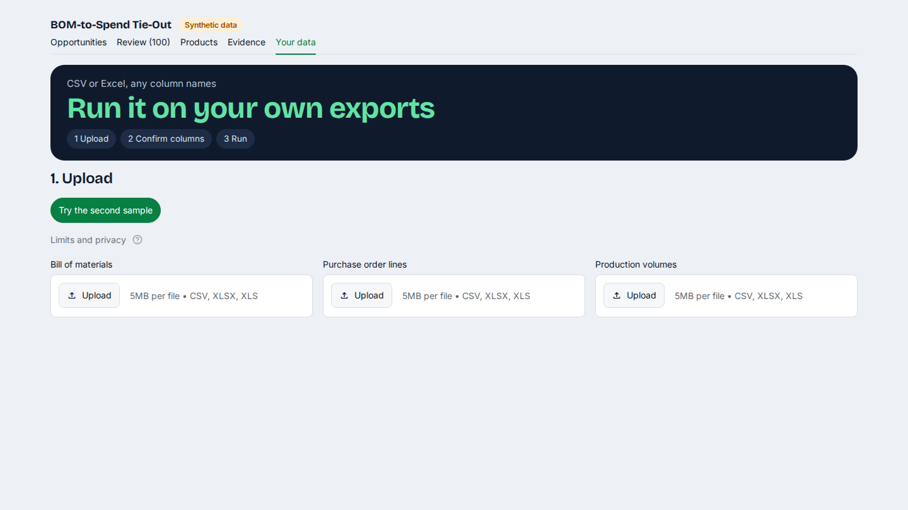

# The app, tab by tab

Every tab opens with the same dark band: one big figure, one line, up to three pills. The screenshots show the built-in sample, which is synthetic.

## Opportunities

A self-contained page (`opportunities.html`) that the app fills with its own data and embeds. The band shows the combined lead range, lead count and share of spend, with "Fix first" bars per product; each lead is split across products by the allocation weights, and clicking a product filters the cards. Below are owner filters (buyer, engineer, service) and one card per lead with a short action sentence, a price or quantity comparison and the range. Opening a card shows what to check before acting, the products that use the part, and the purchase lines with their source file and row; a lead can be marked validated or rejected there, and validated dollars show in the band. Similar-part ideas sit under their own filter, "Ideas to confirm", with "Engineering must confirm" as their first check; they are not in the "Everyone" or Engineer counts and are never counted in the totals. A "Period" control in the filter row narrows every tab to a range of quarters.

## Review

The queue on the left, grouped so lines with identical text are one item, and the detail on the right: decision buttons, what approving would settle, the PO text and BOM description with shared words in bold, Claude's reason, price and supplier evidence, and the source file and row. Saved decisions (undo, clear, download) are at the bottom. Keyboard: A approves, X rejects, N marks not a BOM part.

## Products

The product with the largest lead range, then BOM standard versus estimated actual per unit, the shared-parts network, the engineering changes, the parts driving the difference, the BOM in effect on any date, the cost trend by quarter and an estimated inventory view.

## Evidence

Three headline results, the stage chart from a plain part-number lookup to the full pipeline, where the spend ties (buckets, the spend-flow chart, tie-out by quarter), then the full evaluation in collapsed sections, and the limits.

## Your data

Run the matcher on your own CSV or Excel files in three steps (see below). Uploads are limited to 5 MB per file.

## Controls, lead types and design

There is no sidebar. Each control sits where it is used: the "Needs sign-off above" threshold in Review, the switch between the built-in sample and your files in Your data, and the period on Opportunities. The badge by the title reads "Synthetic data" for the built-in sample and "Your files" otherwise.

Lead types: same part at different supplier prices, spares bought at a premium, duplicate internal part numbers, bought more than the builds required, and **similar parts to consolidate**. The last pairs BOM parts in the same family whose descriptions differ in one numeric spec by 15% or less, or in the package only. It is labelled "engineering must confirm", it is kept out of the headline range, and it is **unmeasured**: nothing was planted for it, so it has no precision or recall. It currently produces 19 pairs worth $316K to $633K; some pair parts that are plainly not interchangeable (two bearing sizes, for example). For each pair, a one-line note from Claude on what differs is committed in `out/similar_part_notes.json`.

Lead status (validated or rejected) is kept inside the Opportunities page while it is open; it is not saved, and it resets when the data behind the page changes.

The flow chart and the network use ECharts through the `streamlit-echarts` component, which animates changes. If that component cannot be imported, the app falls back to static Altair charts. The whole app uses one set of design tokens taken from the Opportunities page (grey background, white bordered cards, green for money, blue, violet and brown for buyer, engineer and service). Headings are Bricolage Grotesque and body text is Inter, both under the SIL Open Font License and served from `static/`, so the app needs no network for fonts. Captions are at most 12 words; longer explanations sit in a "How to read this" tooltip or a closed section. The Opportunities page is embedded with `st.components.v1.html`, which this Streamlit version (1.67, pinned) marks as deprecated.

## Saved decisions

Every approve, reject or not-a-BOM-part decision is written to `crosswalk.csv` (purchase text and part-number field to BOM part). It applies at once to every line with the same text, persists across sessions, and is the first rule on the next pipeline run. Undo, clear and download are at the bottom of the Review tab. The file is local working state and is gitignored. Leads and product cost also have download buttons.

## Your own files

The Your data tab takes a BOM, purchase lines and production volumes as CSV or Excel. Column names do not need to match: Claude reads the headers and 20 sample rows of each file and proposes a mapping with a confidence per column, which you confirm or fix before anything runs. This needs `ANTHROPIC_API_KEY` (and uses `OPENAI_API_KEY` for embeddings if present, otherwise a local model), in the environment or in `.env.local`.

Uploaded data is matched with rules, embeddings and Claude only. The classifier is skipped: it has to be trained on a company's own confirmed matches, and the external tests show one trained elsewhere does not transfer. There is no ground truth for uploaded files, so the app reports how lines were decided, not accuracy.

`samples/second_company/` holds a small second sample to try this with: a slice of the synthetic data exported with different column names, US dates, a different order-type vocabulary, and the purchase lines as Excel. "Try the second sample" in the Your data tab uses it. It includes the multi-level BOM columns and the continuous materials. On that slice the mapping was right for all 25 columns, and matching reached 99.7% precision and 97.5% recall against the planted truth (259 Claude calls, $2.03, about 85 seconds uncached).
